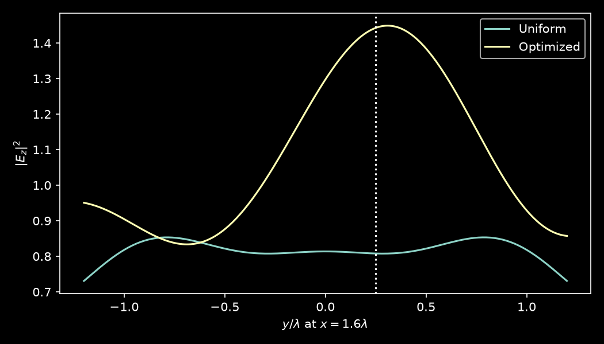

# Quantum Light Forge

Quantum Light Forge explores coherent light scattering from a small atomic array using a weak-driving coupled-dipole model. The interactive controls let you change the array geometry, spacing, detuning, and displayed electric field. The light patterns come from calculated atomic dipoles, while the moving wavefronts show the real part of a harmonic complex field.

The first experiments use scalar outgoing waves, $G_0(r)=e^{ikr}/(4\pi r)$, on a two-dimensional slice of a three-dimensional field. The full model uses fixed $z$-oriented electric dipoles in a free-space vector field. Length is measured in wavelengths, with $k=2\pi/\lambda$, $\epsilon_0=1$, and the radiative linewidth as the frequency unit. The incident field is $E_{\mathrm{inc},z}=e^{ikx}$, using the time convention $E(t)=\mathrm{Re}[E e^{-i\omega t}]$. The outgoing Green tensor and transverse far-field sum follow standard [coupled-dipole theory](https://nano-optics.ac.nz/CoupledDipole.jl/dev/theory/).

For each atom, we solve the fixed-polarization response

$$
p_i=\alpha_i\left[E_{\mathrm{inc},z}(\mathbf r_i)+k^2\sum_{j\ne i}G_{zz}(\mathbf r_i-\mathbf r_j)p_j\right].
$$

The ideal weak-driving polarizability is $\alpha(\Delta)=-(6\pi/k^3)(\Gamma_{\rm rad}/2)/(\Delta+i\Gamma_{\rm tot}/2)$. We exclude self-interaction because radiative damping is already included in $\alpha$ and should not be counted twice. Nonradiative loss is represented by $\Gamma_{\rm tot}>\Gamma_{\rm rad}$. Numerical checks cover the isolated-atom optical-theorem limit, matrix residuals, Green-tensor reciprocity, far-field consistency, and pulse reconstruction.

## Collective response

For a scalar five-atom array with spacing $0.55\lambda$, coupling shifts the response peak from $\Delta=0$ for independent atoms to $0.275\Gamma$. The vector calculation builds on this idea but uses a different, projected Green tensor.

## Steering light with detuning

Changing the local detuning gradient steers the forward-scattered light. Gradients of $-0.7$, $0$, and $+0.7\,\Gamma/\lambda$ place the calculated forward far-field maximum at $-7.5^\circ$, $0^\circ$, and $+7.5^\circ$, respectively. The steering comes from the self-consistent phases of the atomic dipoles.

## Focusing with local detunings

We also optimize the local detunings of a five-atom line to increase the field at a chosen target, located $1.6\lambda$ beyond the array. With bounded detunings, the total-field intensity rises from 0.8079 to 1.4426, an increase of $1.786\times$. The incident field and array geometry stay unchanged. The plotted profile shows both the target and the surrounding field.

## Effects of defects and disorder

A separate nine-atom array shows how small changes can reshape the scattering pattern. Removing one atom shifts the strongest forward lobe from $0^\circ$ to $-1.5^\circ$ and raises the intensity at the chosen probe from 0.839 to 0.935. A seeded position perturbation lowers the probe intensity to 0.789, while a local detuning defect gives 0.778. These are local intensity changes, not measures of total scattering efficiency.

## Pulse propagation

To explore time-dependent light, we send a Gaussian input pulse through the frequency-dependent coupled response and reconstruct the output envelope using Fourier synthesis. At $x=5\lambda$, the incident pulse peaks at $t=0.48\Gamma^{-1}$, close to the chosen geometric delay of $0.5\Gamma^{-1}$.

Truncating frequencies beyond $|\delta|=6\Gamma$ changes the target waveform norm by just $1.09\times10^{-5}$. The finite Fourier window also leaves a small early-time amplitude floor of $6.67\times10^{-4}$. Unlike the harmonic wavefront animation, the pulse movie shows envelope intensity.

## Running the project

Install the dependencies with `python -m pip install -r requirements.txt`, then run `python main.py` to open the Matplotlib dashboard.

After changing physical parameters, click **Update** to recalculate the fields. Play, pause, restart, and display modes reuse the cached complex fields, so they do not require a new calculation.

**Open 3D view** launches a rotatable [radiation surface](figures/radiation3d.html), where the radius represents the calculated intensity normalized to its maximum.

To regenerate the results, run `./regenerate.sh`. This rebuilds the figures, four MP4 videos, GIF, CSV results, and tests. MP4 export requires FFmpeg.

## Scope and limitations

The model describes linear scattering in the weak-excitation regime. It captures collective dipole interactions, interference, beam steering, focusing, and effective pulse propagation, but does not simulate saturation, photon antibunching, many-photon correlations, nonlinear gates, or full Rydberg-EIT dynamics.

For numerical comparisons, validation details, and remaining limitations, see the short [report](report.md).
