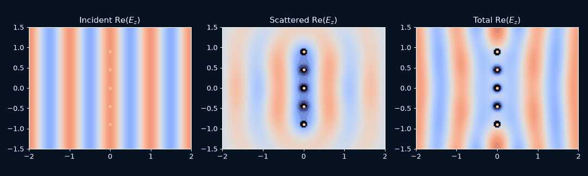
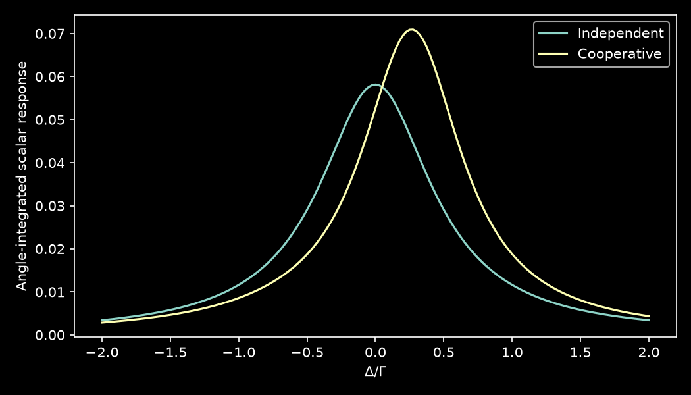
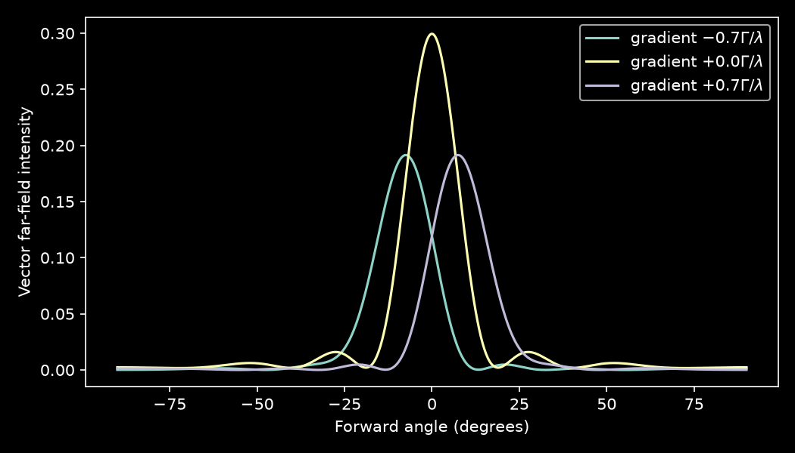
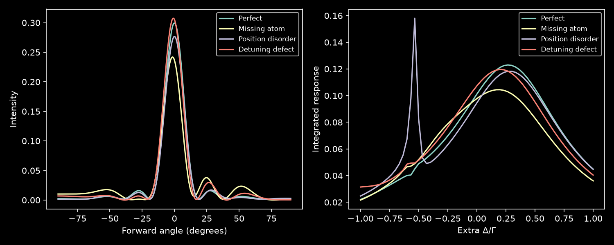
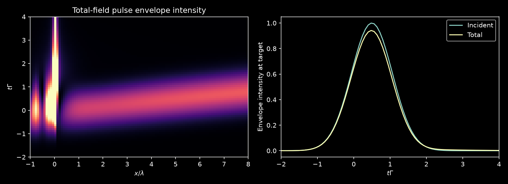
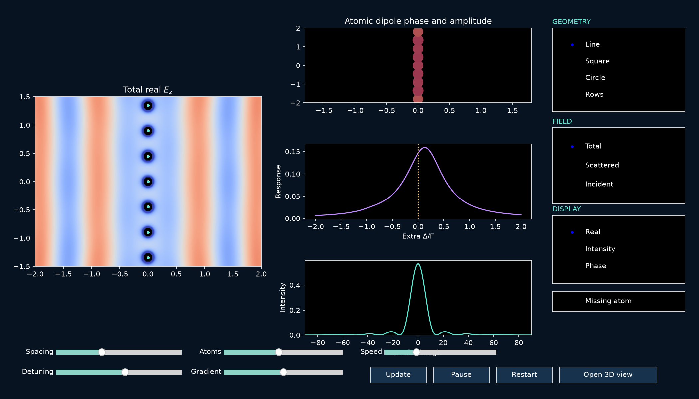

# Quantum Light Forge

Coherent scattering from a small atomic array, calculated with a weak-driving coupled-dipole model. The controls change array geometry, spacing, detuning, and the displayed electric field. The light in the plots comes from solved dipole moments; the moving wavefronts are the real part of a harmonic complex field.

The early experiments use scalar outgoing waves, $G_0(r)=e^{ikr}/(4\pi r)$, on a two-dimensional slice of a three-dimensional field. The mature model uses fixed $z$-oriented electric dipoles in a free-space vector field. Length is measured in wavelengths, $k=2\pi/\lambda$, $\epsilon_0=1$, and the radiative linewidth is the frequency unit. The incident field is $E_{\mathrm{inc},z}=e^{ikx}$ with time convention $E(t)=\mathrm{Re}[E e^{-i\omega t}]$. The outgoing Green tensor and transverse far-field sum follow standard [coupled-dipole theory](https://nano-optics.ac.nz/CoupledDipole.jl/dev/theory/).

For each atom, the fixed-polarization response solves $p_i=\alpha_i[E_{\mathrm{inc},z}(\mathbf r_i)+k^2\sum_{j\ne i}G_{zz}(\mathbf r_i-\mathbf r_j)p_j]$. The ideal weak-driving polarizability is $\alpha(\Delta)=-(6\pi/k^3)(\Gamma_{\rm rad}/2)/(\Delta+i\Gamma_{\rm tot}/2)$. Self-interaction is excluded. Radiative damping is already in $\alpha$ and is not added again. With nonradiative loss, $\Gamma_{\rm tot}>\Gamma_{\rm rad}$. The tests check the isolated-atom optical-theorem limit, matrix residuals, Green-tensor reciprocity, far-field consistency, and pulse reconstruction.

The scalar five-atom array at spacing $0.55\lambda$ has a response peak at $\Delta=0.275\Gamma$; independent atoms peak at zero. This is a result of that intermediate scalar model, not a universal shift. The vector calculation uses a different projected Green tensor.

A detuning gradient of $-0.7$, $0$, and $+0.7\,\Gamma/\lambda$ moves the calculated forward far-field maximum to $-7.5^\circ$, $0^\circ$, and $+7.5^\circ$. These phases come from self-consistent atomic dipoles. They are not prescribed emitter phases.

At a target $1.6\lambda$ beyond a five-atom line, bounded optimization of local detunings changes total-field intensity from 0.8079 to 1.4426, a factor of 1.786. Incident amplitude and geometry are identical. The plotted line profile shows the target point and the surrounding field.

For a separate nine-atom line, removing one atom shifts the strongest forward lobe from $0^\circ$ to $-1.5^\circ$ and changes intensity at the chosen probe from 0.839 to 0.935. A seeded position perturbation lowers that probe intensity to 0.789. A local detuning defect gives 0.778. Defects need not always reduce intensity at one point; they alter interference. An optional spatial detuning shift from a nearby ancilla changes the scattering pattern, but it is only an effective conditional response.

A Gaussian input pulse is propagated by solving the frequency-dependent coupled response, then Fourier synthesizing the output envelope. The incident peak at $x=5\lambda$ arrives at $t=0.48\Gamma^{-1}$, close to the chosen geometric delay of $0.5\Gamma^{-1}$. Truncating frequencies beyond $|\delta|=6\Gamma$ changes the target waveform norm by $1.09\times10^{-5}$. The finite Fourier window leaves an early-time amplitude floor of $6.67\times10^{-4}$. The pulse movie shows envelope intensity; it is distinct from a harmonic phase animation.

Run `python -m pip install -r requirements.txt`, then `python main.py` for the Matplotlib dashboard. Use **Update** after changing physical parameters; play, pause, restart, and display modes reuse cached complex fields. **Open 3D view** opens a rotatable [radiation surface](figures/radiation3d.html) whose radius is the calculated intensity divided by its maximum. `./regenerate.sh` rebuilds the figures, four MP4s, GIF, CSV results, and tests. An FFmpeg executable is needed for MP4 export.

The model is linear and weakly excited. It does not calculate saturation, photon antibunching, many-photon correlations, nonlinear gates, or full Rydberg-EIT dynamics. The short [report](report.md) gives the numerical comparisons and remaining limitations. This is an exploratory simulation, not an experimental validation.
